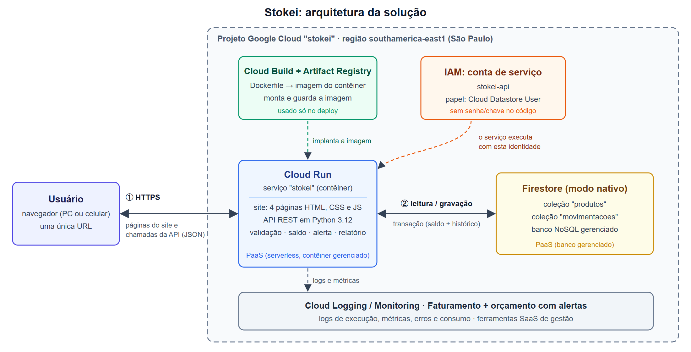

# Stokei: controle de estoque na nuvem (Google Cloud)

Aplicação web de gerenciamento de estoque para pequenos negócios. Permite:

- cadastrar produtos (código, nome, categoria, quantidade, mínimo e preço)
- buscar produtos
- registrar entradas e saídas
- ver alertas de estoque abaixo do mínimo
- acompanhar um dashboard com o resumo do estoque
- consultar o histórico de movimentações

Projeto final da disciplina de Cloud Computing (UNIMA). O enunciado pede Microsoft Azure; o motivo da troca para o Google Cloud está em [`docs/01-planejamento.md`](docs/01-planejamento.md#restrições-encontradas).

## Documentação do projeto

| Etapa | Documento |
|---|---|
| 1. Planejamento | [`docs/01-planejamento.md`](docs/01-planejamento.md) |
| 2. Arquitetura | [`docs/02-arquitetura.md`](docs/02-arquitetura.md), com o diagrama em [`docs/arquitetura.png`](docs/arquitetura.png) |
| 3. Configuração da nuvem | [`docs/03-configuracao.md`](docs/03-configuracao.md): passo a passo e checklist de prints |
| 4. Desenvolvimento | [`docs/04-desenvolvimento.md`](docs/04-desenvolvimento.md) |
| 5. Testes | [`docs/05-testes.md`](docs/05-testes.md), com as evidências em [`docs/evidencias/`](docs/evidencias/) |
| 6. Apresentação | [`docs/06-apresentacao.md`](docs/06-apresentacao.md): roteiro, demonstração e perguntas |
| Relatório técnico | [`docs/relatorio/relatorio.pdf`](docs/relatorio/relatorio.pdf), gerado a partir de `relatorio.html` |

## Arquitetura



| Serviço Google Cloud | Papel | Equivalente Azure |
|---|---|---|
| Projeto do Google Cloud | Agrupa recursos, permissões e faturamento | Resource Group |
| Cloud Run | Roda o contêiner `stokei`, que entrega o site (HTML, CSS, JS) e a API com as regras de negócio (Python) | Azure Container Apps / App Service |
| Firestore | Guarda produtos e histórico | Table Storage / Cosmos DB |
| Cloud Build e Artifact Registry | Montam e guardam a imagem do contêiner a partir do `Dockerfile` | Azure Container Registry |

## Estrutura

```
Dockerfile                 imagem única do Stokei (API + site) para o Cloud Run
api/                       API (Python 3.12); também entrega o site quando STOKEI_WEB está definido
  main.py                  ponto de entrada HTTP, rotas e acesso ao Firestore
  estoque.py               regras de negócio (funções puras)
  memoria.py               repositório em memória (testes e execução local)
  tests/                   64 testes (pytest)
web/                       site (HTML, CSS e JS puros)
  index.html               Dashboard
  produtos.html            cadastro, busca e lista de produtos
  movimentacoes.html       entradas e saídas
  historico.html           histórico de movimentações
  style.css                visual de todas as páginas
  config.js                endereço da API (vazio = mesmo endereço do site)
  comum.js                 chamada à API e peças de tela compartilhadas
  dashboard.js · produtos.js · movimentacoes.js · historico.js
scripts/
  deploy.sh                cria a infraestrutura e publica (Cloud Shell)
  testar-api.sh            executa os testes da Etapa 5 contra a API
servidor-teste/            servidor Flask mínimo para testar a configuração do Google Cloud (com Dockerfile)
docs/                      documentação das etapas, diagrama, evidências e relatório
```

## API

As rotas abaixo são relativas à URL do serviço. No mesmo endereço, `/` abre o site.

| Método | Rota | Corpo / parâmetros | Resposta |
|---|---|---|---|
| GET | `/produtos` | `?busca=texto` (nome, código ou categoria) | lista de produtos com `alerta` |
| POST | `/produtos` | `{"codigo", "nome", "categoria", "quantidade", "minimo", "preco"}` (só `nome` é obrigatório) | 201 + produto |
| DELETE | `/produtos/{id}` | — | 204 |
| POST | `/movimentacao` | `{"id", "tipo": "entrada"\|"saida", "quantidade"}` | produto atualizado |
| GET | `/movimentacoes` | `?produto_id=` (opcional) | últimas 50 movimentações |
| GET | `/relatorio` | — | `total_produtos`, `total_itens`, `valor_total`, `abaixo_do_minimo` |

Erros voltam como `{"erro": "mensagem"}`, com status 400 (entrada inválida, saldo insuficiente, código repetido) ou 404 (produto ou rota inexistente).

## Implantação no Google Cloud

O passo a passo completo, com os prints a tirar, está em [`docs/03-configuracao.md`](docs/03-configuracao.md). Versão curta, no **Cloud Shell**:

```
git clone https://github.com/portelav/stokei.git stokei && cd stokei
bash scripts/deploy.sh <ID-do-projeto>
bash scripts/testar-api.sh <URL-mostrada-pelo-deploy>
```

O `deploy.sh` executa, nesta ordem:

1. ativa as APIs necessárias
2. cria o Firestore (São Paulo)
3. cria uma conta de serviço que só acessa o Firestore
4. monta a imagem pelo `Dockerfile` (Cloud Build) e publica o serviço `stokei` no Cloud Run, com no máximo 2 instâncias
5. restringe o CORS ao endereço do próprio serviço

## Rodar localmente

```
cd api
python -m venv .venv
.venv\Scripts\activate                 # Windows (Linux/Mac: source .venv/bin/activate)
pip install -r requirements-dev.txt
pytest                                 # 64 testes
```

Para subir o site e a API sem nuvem, com os dados em memória (que se perdem ao parar o servidor):

```
set STOKEI_MEMORIA=1                   # Linux/Mac: export STOKEI_MEMORIA=1
set STOKEI_WEB=..\web                  # Linux/Mac: export STOKEI_WEB=../web
functions-framework --target=api --port=8080
```

Abra http://localhost:8080. Para testar a API: `bash scripts/testar-api.sh http://localhost:8080`.

Com Docker, na raiz do repositório:

```
docker build -t stokei .
docker run --rm -p 8080:8080 -e STOKEI_MEMORIA=1 stokei
```

Para rodar localmente contra o Firestore real, faça `gcloud auth application-default login`, defina `GOOGLE_CLOUD_PROJECT=<ID-do-projeto>` e suba o servidor sem `STOKEI_MEMORIA`.

## Segurança

- **Credenciais:** nenhuma no código. O serviço usa uma conta de serviço própria, com permissão só no Firestore (`roles/datastore.user`).
- **Rede:** comunicação só por HTTPS; o site chama a API no mesmo endereço, e o CORS fica restrito a esse endereço.
- **Contêiner:** a imagem só leva o código da API e o site, e o processo não roda como root.
- **Entradas:** toda entrada é validada no servidor. A interface usa `textContent`, nunca `innerHTML` com dados do usuário (evita XSS).
- **Custos:** número máximo de instâncias limitado e orçamento com alertas.

Limitação conhecida: não há login, então qualquer pessoa com a URL pode alterar o estoque. Ver as melhorias propostas em [`docs/05-testes.md`](docs/05-testes.md#limitações-conhecidas).
