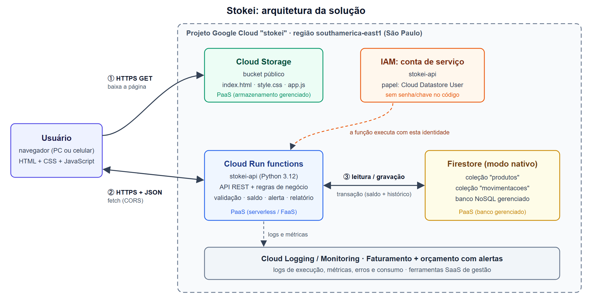
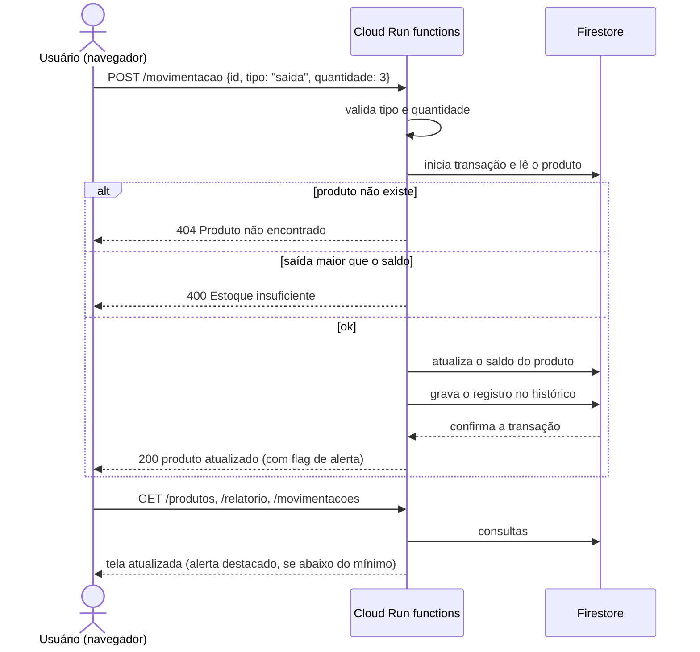

# Etapa 2 — Arquitetura da solução

## Diagrama

O diagrama também está em `arquitetura.svg` (editável) e `arquitetura.png` (para colar no relatório ou no Google Docs).

## Componentes

| Componente | Serviço | O que faz |
|---|---|---|
| Interface web | **Cloud Storage** (bucket público) | Guarda e entrega os arquivos do site: quatro páginas HTML (Dashboard, Produtos, Movimentações e Histórico), um CSS e os scripts em JavaScript. O navegador baixa os arquivos e executa o JavaScript localmente |
| API e regras de negócio | **Cloud Run functions** (`stokei-api`, Python 3.12) | Recebe as requisições HTTP, valida os dados e aplica as regras (saldo não pode ficar negativo, código único, alerta de mínimo, busca, relatório). Responde em JSON |
| Banco de dados | **Firestore** (modo nativo) | Armazena os produtos (coleção `produtos`) e o histórico (coleção `movimentacoes`) |
| Identidade da função | **IAM, conta de serviço** `stokei-api` | Identidade com que a função roda. Tem apenas o papel *Cloud Datastore User*, ou seja, só pode ler e gravar no Firestore |
| Gestão | **Cloud Logging / Monitoring, Faturamento** | Logs de cada execução, métricas (requisições, latência, erros), consumo e orçamento com alertas |
| Agrupamento | **Projeto do Google Cloud** | Contém todos os recursos, permissões e o faturamento (papel equivalente ao Resource Group do Azure) |

## Comunicação entre os componentes

| # | De → Para | Protocolo | Conteúdo |
|---|---|---|---|
| ① | Navegador → Cloud Storage | HTTPS (GET) | Baixa as páginas HTML, o CSS e os scripts JS |
| ② | Navegador ↔ Cloud Run functions | HTTPS + JSON (`fetch`), com CORS liberado só para a origem do site | Requisições da API e respostas |
| ③ | Cloud Run functions ↔ Firestore | Biblioteca cliente do Google (gRPC sobre TLS), autenticada pela conta de serviço | Leitura e gravação de documentos, em transação |
| — | Cloud Run functions → Cloud Logging | Automático | Logs e métricas de cada execução |

Toda a comunicação é criptografada (HTTPS/TLS). O navegador nunca fala direto com o banco: todo acesso aos dados passa pela função, que valida as regras.

### Rotas da API

| Método | Rota | Função |
|---|---|---|
| GET | `/produtos?busca=` | Lista produtos (busca por nome, código ou categoria) e indica quais estão em alerta |
| POST | `/produtos` | Cadastra produto (recusa código repetido) |
| DELETE | `/produtos/{id}` | Remove produto |
| POST | `/movimentacao` | Registra entrada ou saída |
| GET | `/movimentacoes?produto_id=` | Histórico (últimas 50) |
| GET | `/relatorio` | Dados do dashboard |

### Fluxo de uma movimentação (exemplo: saída de estoque)

A atualização do saldo e a gravação no histórico acontecem na **mesma transação**. Se uma das duas falhar, nenhuma é gravada. Se duas saídas chegarem ao mesmo tempo, o Firestore garante que uma seja processada depois da outra, já com o saldo atualizado. Assim o estoque nunca fica errado nem negativo.

### Modelo de dados (Firestore)

**Coleção `produtos`** (um documento por produto, ID gerado automaticamente):

| Campo | Tipo | Exemplo |
|---|---|---|
| `codigo` | texto (único, opcional) | "CAN-01" |
| `nome` | texto | "Caneta azul" |
| `categoria` | texto (opcional) | "Papelaria" |
| `quantidade` | inteiro | 12 |
| `minimo` | inteiro | 5 |
| `preco` | número | 2.50 |

**Coleção `movimentacoes`** (um documento por entrada ou saída):

| Campo | Tipo | Exemplo |
|---|---|---|
| `produto_id` | texto | "a1b2c3…" |
| `produto_nome` | texto | "Caneta azul" |
| `tipo` | texto | "saida" |
| `quantidade` | inteiro | 3 |
| `saldo` | inteiro | 9 (saldo após a operação) |
| `data` | data/hora | definida pelo servidor |

## Modelos de serviço: IaaS, PaaS e SaaS

**Definições:**

- **IaaS (Infraestrutura como Serviço).** O provedor entrega infraestrutura básica: máquinas virtuais, discos, redes, armazenamento. O cliente cuida do sistema operacional, do software e da aplicação.
- **PaaS (Plataforma como Serviço).** O provedor entrega uma plataforma pronta para executar código ou guardar dados. O cliente só cuida da aplicação e dos dados; servidor, sistema operacional e escala ficam com o provedor.
- **SaaS (Software como Serviço).** O provedor entrega um software pronto, usado pelo navegador. O cliente só usa.

**Classificação dos serviços do projeto:**

| Serviço | Modelo | Por quê |
|---|---|---|
| Cloud Storage | **PaaS** (armazenamento gerenciado) | O grupo só envia os arquivos do site. O Google cuida de discos, replicação, disponibilidade e da entrega por HTTPS, sem servidor web para configurar |
| Cloud Run functions | **PaaS** (serverless / FaaS) | O grupo entrega só o código Python. O Google cuida de servidor, sistema operacional, runtime Python, escala e disponibilidade, e cobra por execução |
| Firestore | **PaaS** (banco gerenciado) | O grupo define coleções e documentos. O Google cuida de instalação, replicação, backup da infraestrutura e escala |
| Console, Cloud Logging/Monitoring, Faturamento | **SaaS** | Ferramentas prontas, usadas pelo navegador, para administrar e acompanhar o projeto |
| **O próprio Stokei** | **SaaS** (do ponto de vista do cliente) | O dono do negócio usa o sistema pelo navegador, sem instalar nada e sem saber onde ele roda. É exatamente o modelo SaaS |

**Por que não há IaaS:** o modelo predominante é o PaaS. O IaaS só apareceria se o grupo usasse uma máquina virtual (Compute Engine) e instalasse o servidor por conta própria. Essa opção foi descartada (ver "Decisões de arquitetura"). Alguns materiais classificam o armazenamento de objetos (Cloud Storage) como IaaS por ser "infraestrutura de armazenamento". Aqui ele foi tratado como PaaS porque o grupo não gerencia nenhuma infraestrutura dele, apenas envia arquivos.

**Responsabilidades (quem cuida de quê):**

| Camada | Se fosse IaaS (máquina virtual) | No Stokei (PaaS/serverless) |
|---|---|---|
| Código e regras de negócio | grupo | grupo |
| Dados | grupo | grupo |
| Runtime (Python) e bibliotecas do sistema | grupo | **Google** |
| Sistema operacional e atualizações de segurança | grupo | **Google** |
| Servidor, escala e disponibilidade | grupo | **Google** |
| Hardware, rede e datacenter | Google | Google |

## Decisões de arquitetura

| Decisão | Alternativa descartada | Motivo |
|---|---|---|
| Função serverless (PaaS) | Máquina virtual com servidor web (IaaS) | A VM fica ligada e cobrando 24h, exige atualizar o sistema operacional e configurar o servidor. A função só roda quando é chamada e cabe na cota gratuita |
| Firestore (NoSQL) | Cloud SQL (banco relacional) | O Cloud SQL não tem cota gratuita e cobra por hora ligado. O modelo de dados é simples (2 coleções) e o Firestore tem transações, que garantem a consistência do saldo |
| Página estática no Cloud Storage | Servidor web próprio para a interface | A interface é só HTML, CSS e JS. Servir direto do storage dispensa servidor e custa praticamente zero |
| Acesso ao banco só pela função | Navegador acessando o banco direto | Concentra as regras de negócio e a validação num só lugar e não expõe credenciais no navegador |
| Região `southamerica-east1` (São Paulo) | Regiões nos EUA | Menor latência para usuários no Brasil |
